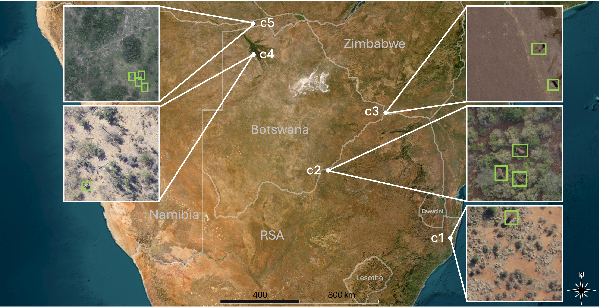

# WildFL - Federated Learning for Aerial Wildlife Monitoring



This repository contains all code necessary to recreate the federated learning (FL) setup presented in  the paper "Federated Learning Enables Low-Cost Collaborative Aerial
Wildlife Censuses Across Borders" (currently under review). While the dataset used for this study is [publicly available](https://openaccess.thecvf.com/content_CVPRW_2019/html/DOAI/Naude_The_Aerial_Elephant_Dataset_A_New_Public_Benchmark_for_Aerial_CVPRW_2019_paper.html), we cannot openly share the exact client splits out of data privacy concerns. All information necessary to assign individual images to clients was made available to us upon request to the authors of the dataset. Users attempting to reproduce our results are encouraged to follow the same procedure.

## Repository Content

Implementations of all FL algorithms can be found in the `./algorithms` folder, and  `helpers.py` contains auxilliary functions necessary to run everything exactly as was done in the aforementioned paper. Note that we provide these helper functions to facilitate precise reproduction of our methodology, but since the content of `helpers.py`  mainly concerns model evaluation, modification or replacement with alternative evaluation pipelines should yield comparable results. Further instructions can be found in `example_usage.ipynb`.

## Prerequisites

#### Data Layout

All algorithms operate on a prepared dataset directory (`data_dir`) containing one subdirectory per client.
Each client holds image *patches* for training (in Ultralytics YOLO format) and *full-size images* for
evaluation:

```text
data_dir/
├── client_stats.json            # per-client dataset statistics (used to weight the aggregation)
├── c1/
│   ├── dataset.yaml             # Ultralytics dataset file, pointing to the train/val patch directories
│   ├── train/                   # training patches (images + YOLO label files)
│   ├── val/                     # validation patches
│   └── val_full_imgs/           # evaluation split: full-size images
│       ├── annotations.json     # image name -> list of box annotations
│       ├── dataset_SAHI.json    # dataset description for tiled (SAHI) inference
│       └── image_counts/        # one .json per image with ground-truth counts per class
├── c2/
│   └── ...
└── all_data/                    # optional "centralized" client: the union of all clients' data
    └── ...
```

Three files deserve special attention:

- **`client_stats.json`** (top level) describes every client's data distribution. The algorithms read the number
  of training *annotations* per class to derive each client's aggregation weight (FedNova additionally uses the
  patch counts to determine the number of local optimization steps):

  ```json
  {
   "c1": {"data": {"train": {"anns": {"0": 4018},
                             "images": 130,
                             "patches": {"patches_kept": 1697, "...": "..."}},
                   "val":   {"...": "..."}}},
   "c2": {"...": "..."}
  }
  ```
- **`annotations.json`** (inside the evaluation split) maps every image name to its list of annotations. With
  `ann_format="BX_WH"`, a single annotation reads `{"bbox": [x_min, y_min, width, height], "category_id": 0}`.
- **`dataset.yaml`** is the standard Ultralytics dataset file of each client. The number of classes in the model
  configuration YAML is patched automatically before training (`helpers.modify_cfg_yaml_nc`).

The optional `all_data` client contains the pooled data of all clients and can be used to train a centralized `Oracle` model.

All canonical file and directory names are defined in `helpers.NAMES_DIRECTORIES_FILES`

#### Packages and Environment

The present approach requires installing the FL-compatible version of the `ultralytics` YOLO framework, which can be downloaded from [this repository.](https://github.com/gigumay/YOLO4FL) **Importantly**, to run the `MOON` or `FedProto` algorithm,  YOLO must be installed from the corresponding branches (see the YOLO repository's `README`  for details regarding installation). All remaining necessary packages are listed in the `env.yaml` file of this repo.

## Contact Information

For any questions or input on this repository or the underlying paper, please reach out to:

`gigumay@gmail.com`
